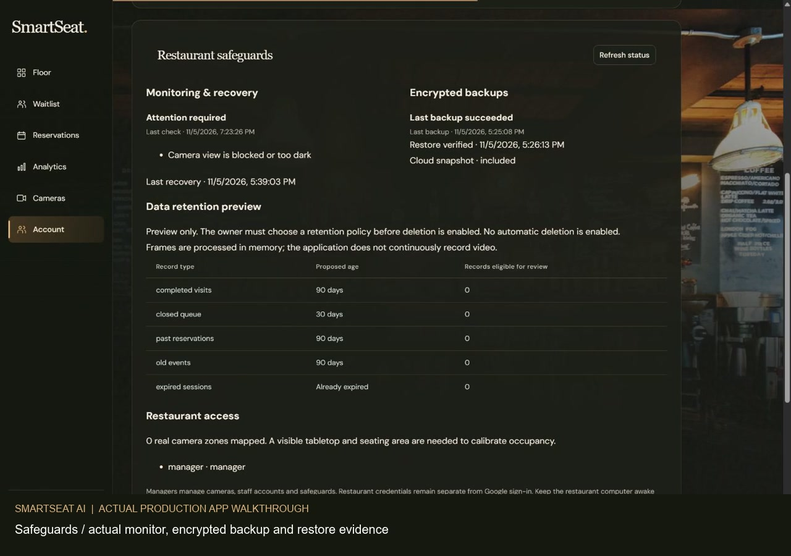
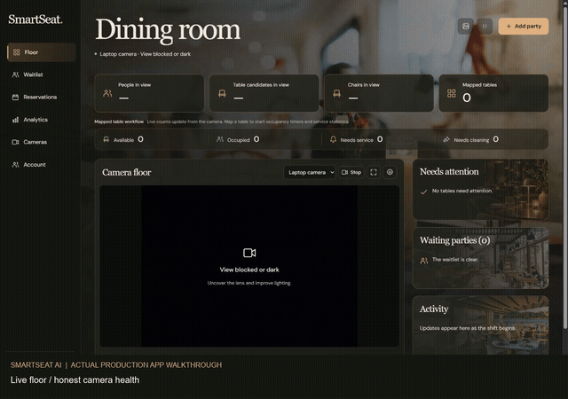
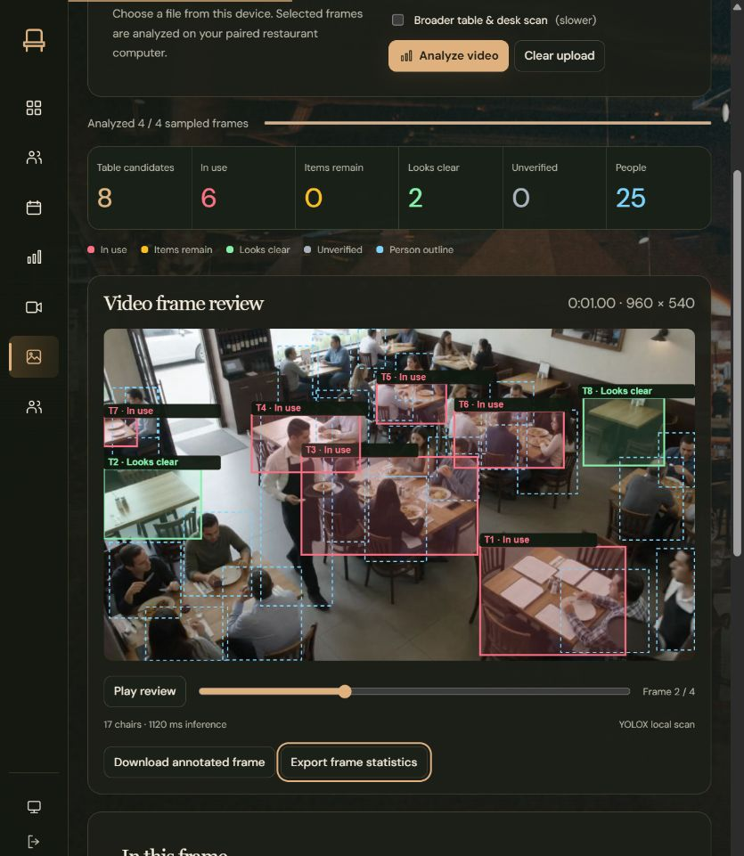
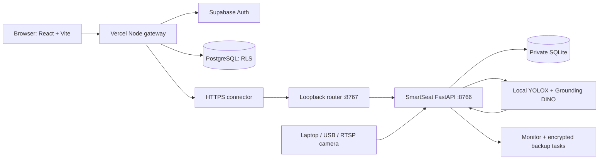

# SmartSeat AI

**A camera-assisted restaurant floor, service and owner reporting web application.**

[Open the live application](https://smartseat-ai-9059.vercel.app/) · [Watch the 2:33 walkthrough](https://9059rohith.github.io/smartseat-ai/) · [Download MP4](https://github.com/9059Rohith/smartseat-ai/releases/download/v1.0-demo/smartseat-demo.mp4) · [Release checklist](docs/TOP_QUALITY_CHECKLIST.md) · [Deployment guide](docs/public-deployment.md)

[](https://9059rohith.github.io/smartseat-ai/)

<details>
<summary>20-second animated preview of the actual application</summary>



</details>

> **Release status, 5 November 2026:** The deployed web app, real Google sign-in, separate restaurant pairing, local camera engine, reports, CSV export, monitoring and encrypted backups have been exercised. The demo records the real deployed app. At recording time the laptop camera was dark/covered and there were **zero mapped tables**. It does not demonstrate a successful physical table-occupancy-cleaning cycle. Restaurant accuracy, a full staffed shift, public email signup delivery and always-on availability still need acceptance. No universal 100% accuracy or availability claim is made.

## Contents

- [Demo and what it proves](#demo-and-what-it-proves)
- [Features](#features)
- [Uploaded image and video analysis](#uploaded-image-and-video-analysis)
- [How table detection works](#how-table-detection-works)
- [Occupancy and cleaning](#occupancy-and-cleaning)
- [Architecture](#architecture)
- [Windows quick start](#windows-quick-start)
- [Map your restaurant](#map-your-restaurant)
- [Owner analytics](#owner-analytics)
- [Authentication and database](#authentication-and-database)
- [Public deployment](#public-deployment)
- [Security and privacy](#security-and-privacy)
- [Backups and monitoring](#backups-and-monitoring)
- [Verification](#verification)
- [Troubleshooting](#troubleshooting)
- [Project structure](#project-structure)
- [Acceptance checklist](#acceptance-checklist)
- [Attribution and licenses](#attribution-and-licenses)

## Demo and what it proves

**[Full MP4 walkthrough — approximately 2 minutes 33 seconds](https://github.com/9059Rohith/smartseat-ai/releases/download/v1.0-demo/smartseat-demo.mp4)**

The recording is a browser screencast of [the production deployment](https://smartseat-ai-9059.vercel.app/), captured on 5 November 2026. The screen capture samples approximately two frames per second and is encoded as a standard H.264 MP4. Chapter labels sit below the application; they do not replace application data. There is no synthetic voiceover, fabricated dashboard or seeded restaurant history.

| Approximate time | Shown in the actual application |
| --- | --- |
| 0:00–0:25 | Floor, camera health, real empty workspace and mapped-table counters |
| 0:25–0:38 | Guest entry form, opened and cancelled without submitting invented guests |
| 0:38–0:56 | Reservations and booking prerequisites |
| 0:56–1:25 | Actual day-to-day/weekend reports and CSV export availability |
| 1:25–1:47 | Laptop source and table-zone setup; no fictional polygon or capacity saved |
| 1:47–2:13 | Actual monitor warning, encrypted backup, restore evidence and retention preview |
| 2:13–2:33 | Floor and secure signed-out screen with Google sign-in |

The camera's blocked-view warning and zero history are intentional, truthful observations. The recording is a product walkthrough, **not** a restaurant field-accuracy benchmark. Google OAuth was exercised again after recording and the existing restaurant connection restored. Account chooser details and credentials are excluded from the published video.

A separately selectable DineAssist development clip is included under `demo/`, with its upstream license. **That clip is AI-generated test footage.** It is not live CCTV, not a real restaurant acceptance test, and is not substituted into the default webcam workspace or this walkthrough.

See [demo provenance and chapter notes](docs/demo.md).

## Features

| Area | Implemented behavior |
| --- | --- |
| Live floor | Authenticated camera preview; real person, table-candidate and chair counts; explicit fresh/stale/blocked/offline states |
| Table setup | Review detected proposals, enter real names/capacities, draw table-and-chair polygons, select camera and automatic/manual updates |
| Media Analysis | Separate image/video upload workspace, real colored table outlines, one frame-statistics bar, sampled video review and annotated-frame/CSV downloads |
| Occupancy | Sustained visible presence/absence against configured zones; visit lifecycle and unknown/stale evidence handling |
| Service | Greeting deadlines, departure/cleaning workflow and staff-confirmed cleaning |
| Visual surface checks | Supported dining-item detection; items remain, looks clear, in use or unverified suggestions |
| Host stand | Waitlist, table assignment/call workflow, expiring holds, reservations and conflict checks |
| Owner reporting | Daily, weekly, weekend and selected-period reports, daily/per-table breakdowns and CSV export |
| Identity | Real Google OAuth, managed server-validated sessions and private owner workspace |
| Camera authorization | Separate local manager/staff credentials; a Google account alone grants no restaurant-camera access |
| Persistence | SQLite operational source of truth; PostgreSQL profiles, memberships, snapshots, report caches and audit events |
| Safeguards | Manager-only monitor/backup status, access inventory and non-destructive retention preview |
| Experience | Responsive React UI, 24 local decorative backgrounds, local fonts, reduced-motion and animation pause controls |

There is no facial identity model. Person IDs are temporary tracking IDs, not names or a unique-customer count. Guest names are entered by authorized staff.

## Uploaded image and video analysis

Open **Media Analysis** in the navbar to inspect an image or recorded video without changing live restaurant records.

1. Choose a JPEG, PNG, WebP or browser-supported video (such as H.264 MP4/WebM), up to **250 MB**; video duration is limited to **10 minutes**.
2. Use the broader table/desk scan for harder still images. Images enable it by default; videos use faster YOLOX sampling by default. Broader CPU scans can take tens of seconds per frame, including a minute under load.
3. Click **Analyze image** or **Analyze video**. The browser decodes the source locally and submits bounded JPEG frames to the paired restaurant engine's actual local models.
4. Review colored table outlines and the single statistics bar for the selected analyzed frame: table candidates, in use, items remain, looks clear, unverified and people.
5. For videos, use **Play review** and the frame slider to inspect time-labeled analyzed snapshots. Export actual per-frame statistics as CSV, or download an annotated frame as PNG.
6. **Stop analysis** stops further frame submissions and discards the pending result. An already-running local model call finishes in the background; it cannot be interrupted mid-inference. **Clear upload** resets the browser's analysis.

| Color | Frame-level observation |
| --- | --- |
| Red | In use: a supported person detection overlaps this proposed table region |
| Amber | Items remain: supported dining items are visible without an overlapping person |
| Green | Looks clear: no supported items/person overlap detected; **not sanitation or confirmed cleaning** |
| Gray | Unverified visual surface evidence |
| Blue dashed outline | Person proposal |

Video analysis samples across the clip's duration, up to **120 frames**. Review playback shows those snapshots; it is not continuous tracking or every-frame analysis. T-numbers and counts apply to one analyzed frame, not unique tables or guests across the clip. A single frame cannot confirm actual seating or distinguish a passerby from a diner.

The upload-only person threshold is more conservative than the continuous live-camera tracker (0.40 versus 0.25), following an actual empty-table/chair false-positive regression check. This reduces that observed false overlap and can miss weaker person detections; it is not a universal accuracy guarantee. The existing live-camera threshold and workflow are unchanged.

The original file remains in the browser. Selected JPEG frames reach the same authenticated restaurant engine through the public gateway and are processed in memory. Jobs are scoped to the engine user, retained for at most five minutes, bounded to two unfinished jobs and twenty retained jobs, and deleted by the browser after each result. No media upload creates tables, visits, reservations, cleanings or cloud owner-report data. The laptop/engine must be online and paired.

Public requests are split into frames because [Vercel Functions limit individual request/response payloads](https://vercel.com/docs/functions/limitations). Only the exact media-analysis POST route allows up to 1 MiB; other gateway body limits remain 64 KiB. JPEG signature, dimensions and decoded pixels are checked on the engine before inference.

[Media feature verification and limits](docs/media-analysis.md)



The screenshot shows actual local-model outputs on the explicitly AI-generated DineAssist development clip uploaded through the production app. It is not live CCTV or restaurant field-accuracy evidence; source/license attribution remains in `demo/DineAssist-LICENSE.txt`.

## How table detection works

1. OpenCV reads the configured laptop/USB camera, supported RTSP feed or explicitly chosen development video.
2. The capture loop drains old frames and analyzes the newest available image rather than building an old-frame backlog.
3. **YOLOX-S ONNX** performs local person, dining-table, chair and supported dining-item inference at its trained 640-pixel input size.
4. **Grounding DINO Tiny** runs slower background scans for broader table/desk proposals.
5. Broad proposals are accepted only while their age, view, visible region and unoccluded background remain sufficiently consistent. Moving person regions are excluded from common visual evidence; proposals are checked independently.
6. The application draws actual proposals with their source and model score. A proposal does not create a saved restaurant table.
7. An authorized manager reviews the region and assigns the real table identity and seating capacity.

A conservative contour aid can refine a weak model proposal when a measured surface contour supports it. It is a setup aid and can still miss tables or suggest other furniture. Scores are model outputs, **not calibrated accuracy percentages**.

Grounding DINO can take roughly 9–20+ seconds on this laptop under load. Person inference and preview continue separately. Broad results expire after 30 seconds and can be rejected earlier after a camera/view/region change. Surface evidence expires after five seconds.

Transparent, folded, hidden or unusual surfaces, low light, close crops and steep viewpoints remain difficult. A table outside the camera image cannot be detected. Manual mapping is available for fixed restaurant cameras; it still needs physical validation.

[Latest table-scan verification](docs/table-detection-verification.md) · [Public evaluation provenance](evaluation/public-corpus.json)

## Occupancy and cleaning

These are separate observations:

| Signal | Meaning | Does not establish |
| --- | --- | --- |
| Person in view | A detected person is visible somewhere in this camera | A seated customer or unique guest |
| Table candidate | The model proposes a table/desk region | A saved table, its name or capacity |
| Mapped-table occupancy | Sustained presence intersects a configured seating region | Perfect recognition under occlusion or crowded aisles |
| Items remain | Supported cups, bowls, bottles, utensils or food are visible | That dishes are dirty |
| Looks clear | Fresh supported evidence finds no supported items on an observed table | Sanitation, no stains, no germs or no unsupported items |
| Cleaning confirmed | Staff explicitly confirmed the cleaning action | A computer-vision sanitation certificate |

Supported item checks use YOLOX COCO classes 39–55. Plates and napkins are not covered by that closed-set model. Cleaning is never automatically confirmed by a clear-looking frame.

Sustained absence after a visit produces a cleaning task. Lost camera evidence invalidates pending observations; it is not treated as proof of an empty or cleaned table. Keep the camera fixed and remap after moving it.

## Architecture



- **Standalone local mode:** browser → FastAPI on loopback, normally port 8765. Cloud accounts are optional.
- **This public installation:** dedicated SmartSeat engine on 8766; router on 8767 reserves `/smartseat-engine/*`. Other existing local-app traffic continues to 8765.
- **Cloud identity/data:** Supabase Auth plus PostgreSQL. Camera/model processing stays on the restaurant computer.
- **Frames:** kept in memory by the application and delivered through authenticated camera routes. Hosted Postgres does not store camera frames.
- **Public access:** Vercel serves the UI/gateway; the restaurant engine, connector and laptop must remain running.

Local camera inference has no paid inference API, LLM API or per-frame external AI call. Public deployment necessarily uses HTTP APIs for authentication, database access and the connector. Free hosting quotas and policies still apply; the project does not promise unlimited free infrastructure.

## Windows quick start

### Requirements

- Windows 10/11, Python **3.12**, Node.js **24 LTS**, Git and a working webcam.
- Internet for the first dependency/model downloads; sufficient disk space for PyTorch and approximately 690 MB of broad-detector weights.
- Browser access to `http://127.0.0.1:<port>/`.
- CPU inference is supported. Performance depends on the machine; no GPU is required by the provided CPU setup.
- Enable Windows camera access for desktop apps and close another program if it exclusively owns the device.

### Clone and launch

```powershell
git clone https://github.com/9059Rohith/smartseat-ai.git
Set-Location smartseat-ai
.\Run-SmartSeat.ps1 -Setup -Port 8766
```

Open **http://127.0.0.1:8766/**. The example uses 8766 to avoid this laptop's existing application on 8765. For a clean machine, the launcher's default 8765 is also available.

The launcher creates `.venv`, installs the pinned requirements, downloads the pinned Grounding DINO snapshot, installs frontend packages, builds the UI and starts the actual webcam. Initial setup may take several minutes. The included YOLOX ONNX artifacts are licensed upstream binaries.

If PowerShell blocks scripts, follow your organization's signed-script policy or run the equivalent commands below. No machine-wide execution-policy change is needed.

```powershell
python -m venv .venv
.\.venv\Scripts\python.exe -m pip install -r requirements.txt
.\.venv\Scripts\python.exe -m pip install -r requirements-vision.txt
.\.venv\Scripts\python.exe download_table_model.py
npm.cmd ci --prefix web
npm.cmd run build --prefix web
.\.venv\Scripts\python.exe app.py --webcam --port 8766
```

### First local sign-in

The first run prints a generated **manager** username/password to its local terminal. Keep that password private. A later run does not print or replace the existing password.

For a fresh installation only, `SMARTSEAT_PASSWORD` can supply a password of at least 12 characters before first launch. Never put an actual password into a committed file or public terminal recording.

The default live workspace is empty. It does not create tables, customers, reservations or historical visits.

### Subsequent launches

```powershell
.\Run-SmartSeat.ps1 -Port 8766
```

Or, once dependencies, models and the web build exist:

```powershell
.\.venv\Scripts\python.exe app.py --webcam --port 8766
```

Ctrl+C stops the foreground local engine. See the separate public-installation launcher below for this laptop's configured connector and watchdog.

### Separate development clip mode

```powershell
.\Run-SmartSeat.ps1 -Demo -Port 8768
```

This explicitly selected mode uses `local/demo.sqlite3` and upstream sample zone coordinates, separate from `local/smartseat.sqlite3`. It includes sample configuration and AI-generated test footage. Its documented development login is `demo` / `smartseat-demo`. Never expose that mode as the production restaurant engine or cite its counts as real restaurant traffic.

## Map your restaurant

1. Sign in as a local manager, or sign in with Google and pair the existing restaurant engine in **Account**.
2. Open **Cameras** and confirm the actual picture. Select/start the laptop source, or add the correct USB/RTSP source.
3. Fix the camera above/alongside the dining area so the tabletop, nearby chairs and seating regions are visible. Avoid backlighting and a lens covered by the laptop chassis or privacy shutter.
4. Select **Map this table** on a credible candidate, or **Add table** and draw the real table/seating polygon.
5. Enter its actual name and seat count. Keep traffic lanes out of the region. Check that neighboring seating regions are not mistakenly overlapping.
6. Save only after the visible region matches the physical table. Manual coordinates are available when pointer drawing is inconvenient.
7. Physically test empty → seated → departed. Leave actual cups/items, remove them, wipe the surface, then have staff confirm cleaning.
8. Repeat for crowding, a short customer absence, partial occlusion, darkness and feed interruption. Remap after any camera move.

Entrance/footfall regions need a view of both approach and inward crossing. Avoid overlapping coverage across entrance cameras if the same person could be counted twice.

Do not map an empty wall or assign a fictitious capacity to force nonzero statistics. Unconfigured workspace metrics legitimately remain zero.

## Owner analytics

**Analytics** offers Today, Yesterday, This week, Last week, Last 7 days, Latest weekend and Last 30 days.

Reports include:

- Recorded table visits and known guest totals from entered party sizes.
- Occupied time and occupancy against elapsed mapped-table time.
- Turnover, greeting/dining/cleaning durations and queue wait where actual records exist.
- Staff-confirmed cleanings, daily rows and per-table summaries.
- Configured entrance crossing counts; these are not unique-customer identities.
- CSV export of the displayed actual report.

Reports refresh every five seconds while visible and immediately when returning to the tab. Public floor polling is approximately two seconds; local mode uses server-sent events. Saved cloud reports show their stored timestamp during a disconnected engine.

Visits spanning midnight contribute occupied time to both dates while the seating is counted once. Reporting currently uses a browser-supplied fixed UTC offset; historical periods spanning daylight-saving changes need future timezone-name support. No POS integration exists, so revenue and sales are not inferred.

## Authentication and database

### Two separate authorization layers

1. **Cloud identity:** Google OAuth establishes the verified account and its private owner workspace.
2. **Restaurant access:** existing manager/staff credentials pair the browser to the restaurant engine.

A new Google account cannot automatically view this restaurant's camera. Sign-out clears cloud access and restaurant pairing. A new cloud sign-in requires pairing again. Do not publish engine credentials as a demo convenience.

### Data stores

| Store | Purpose |
| --- | --- |
| Local SQLite | Restaurant cameras, table zones, users, sessions, parties, visits, reservations, events and service state |
| `smartseat_profiles` | Private account display profile |
| `smartseat_workspaces` | Restaurant workspace/settings |
| `smartseat_memberships` | Workspace roles |
| `smartseat_floor_cache` | Actual synchronized floor snapshot |
| `smartseat_report_cache` | Actual cached owner reports |
| `smartseat_daily_metrics` | Normalized daily report rows |
| `smartseat_audit_events` | Constrained account/workspace audit actions |

All seven cloud application tables have row-level security. Anonymous access is revoked. The atomic workspace/audit RPCs bind identity to `auth.uid()`, constrain writes and set an empty search path.

[Database migration](supabase/migrations/20261105081808_cloud_identity_workspaces.sql) · [RLS test](tests/cloud/rls-isolation.sql) · [Auth acceptance](docs/auth-acceptance.md)

### Email authentication status

Email signup/password/recovery interfaces are implemented. The owner's real recovery delivery, PKCE callback and new-password form were verified **without changing the password**.

Public new-user email signup/confirmation and a completed password-change/email-login lifecycle remain unaccepted. Configure authorized production SMTP and test that lifecycle before advertising unrestricted public email signup. Default provider mail restrictions/quotas are not treated as a production email guarantee.

## Public deployment

Live URL: **https://smartseat-ai-9059.vercel.app/**

The existing installation uses the dedicated engine, loopback router, authenticated public gateway and configured HTTPS connector.

```powershell
.\Start-PublicApp.ps1
```

This command is for an **already configured production installation**. It checks the existing database instead of silently creating a replacement. A fresh clone first needs local initialization, private connector configuration and cloud configuration.

### Gateway environment

Configure these in your deployment's server environment; never commit real secrets:

```dotenv
SMARTSEAT_CLOUD_AUTH=1
SMARTSEAT_PUBLIC_ORIGIN=https://your-project.vercel.app
SMARTSEAT_ENGINE_ORIGIN=https://your-engine-host/smartseat-engine
SUPABASE_URL=https://your-project.supabase.co
SUPABASE_PUBLISHABLE_KEY=your-project-publishable-key
```

Use a dedicated Supabase project, apply the migration and configure the exact site and callback redirect allowlist. Configure Google's web OAuth client through Supabase using the provider callback:

```text
https://YOUR_PROJECT_REF.supabase.co/auth/v1/callback
```

The Google client secret belongs only in the provider configuration. Neither a Google secret nor a Supabase service-role key belongs in the frontend bundle.

### This installation's private connector file

Create `local/public-connection.json` privately when setting up a matching installation:

```json
{
  "engine_origin": "https://your-engine-host/smartseat-engine",
  "engine_port": 8766,
  "router_port": 8767,
  "public_origin": "https://your-project.vercel.app",
  "project": "your-project",
  "scope": "your-vercel-scope"
}
```

Review `Start-PublicEngine.ps1`, `Start-PublicApp.ps1`, `connector/ensure_connection.py` and the deployment guide before adapting the installed connector. The connector guard refuses unexpected ownership/configuration. Some installed scripts intentionally contain this release's public project name/origin; a new deployment must update those public settings consistently.

Build and publish the UI/gateway with the authenticated official Vercel CLI:

```powershell
.\Publish-SmartSeat.ps1 -Project your-project -Scope your-vercel-scope
```

The publishing script uses an explicit staging allowlist. It excludes local databases, model weights, camera captures, environment files and credentials. **Vercel does not run this laptop's Python camera inference.**

Availability depends on the restaurant computer being powered, awake and signed in with its engine/connector online. A free laptop tunnel is not an always-on managed production host.

[Detailed deployment and operating instructions](docs/public-deployment.md)

## Security and privacy

- Camera frames, state mutations and reporting routes require appropriate authentication.
- Managed sessions are validated server-side; cookies use Secure/HttpOnly protections in public mode, with OAuth-compatible SameSite behavior.
- Local passwords are hashed; local session tokens are stored as digests.
- Google identity and engine manager/staff authorization remain independent.
- Cross-workspace database isolation is enforced by RLS and tested transactionally.
- Gateway controls bound auth attempts, mutations, request rates, bucket memory and actual UTF-8 body size.
- These gateway limits are **best-effort per-instance**, not a distributed global rate limiter.
- Origin checks, bounded connector replies, exact service identity and unexpected-port guards prevent silent routing to another local app.
- Operational logs avoid passwords, cookies, raw IPs, camera URLs, guest names and camera pixels.
- The app does not continuously record video or create face templates.
- Public repository/release artifacts exclude the real database, OAuth JSON, session cookies, local configuration and private diagnostic captures.

The explicitly requested walkthrough is an exported public screencast. It is separate from ordinary application camera retention.

## Backups and monitoring

**Encrypted backup:** Windows DPAPI CurrentUser encrypts the archive. SQLite's online backup includes committed WAL content; SHA-256 hashes, integrity checks and isolated restoration verify the snapshot. The configured cloud snapshot covers seven application tables and migration metadata. Archive ACLs restrict access to the Windows user and SYSTEM.

The installed native task runs daily at **02:30 Asia/Kolkata** and at logon. Its actual scheduled run and isolated file restore passed.

Limitations: the current archive is local to the laptop and its Windows DPAPI profile. It is not an offsite backup and does not include Supabase Auth, storage or all provider configuration. Full hosted disaster recovery remains unaccepted.

**Health monitor:** checks engine/router/public service identity, records bounded private incidents and recovers genuine engine/connector outages with cooldowns. Camera darkness is an alert, not a restart loop. Missing, empty, corrupt or foreign databases block recovery instead of being replaced.

The enabled native logon task runs as the current Windows user. Actual engine and router failure/recovery drills passed. A future real Windows logon and unattended 24/7 operation still need observation.

**Retention:** the manager panel shows proposed retention ages and eligible counts. It is preview-only; no automatic purge is enabled. The restaurant owner must choose the policy and real staff assignments.

[Backup/restore guide](docs/backups.md) · [Monitor guide](docs/monitoring.md) · [Data/staff-access guide](docs/data-and-staff-access.md)

## Verification

Run from the project root after installing the relevant base/vision dependencies:

```powershell
.\.venv\Scripts\python.exe -m pip install -r requirements-test.txt
.\.venv\Scripts\python.exe -m unittest discover -s tests -q
npm.cmd ci --prefix deployment
node --test tests/cloud/abuse.test.cjs tests/cloud/auth-acceptance.test.cjs tests/cloud/connector.test.cjs tests/cloud/media-helpers.test.cjs
npm.cmd ci --prefix web
npm.cmd run build --prefix web
```

The latest software checkpoint passed **61 Python tests and 25 Node tests**, plus the production web build. Python coverage includes real YOLOX inference on the explicitly labeled upstream test clip, occupancy/service rules, visual evidence freshness, reports, reservations, database safeguards, connector handling, encrypted backups and watchdog boundaries. Node checks include auth/session failures, rate/body bounds and stream interruptions.

The safe live auth probe does not create accounts, send email or insert restaurant records:

```powershell
node tests/cloud/auth-acceptance-live.cjs
```

Review its target configuration before using it on your deployment.

Broader table evaluation:

```powershell
.\.venv\Scripts\python.exe evaluation/evaluate_tables.py --rotations
```

The public corpus contains eight photographs and one rendered illustration with source/license metadata. Previous checks on eight inputs in four rotations returned at least one candidate in 23 of 32 cases; **that is not precision, recall or an accuracy measurement**. Known misses and box errors remain. Rotating an image is not the same as testing different real camera viewpoints.

Test fixtures and isolated test databases are not live restaurant data. Passing software tests does not complete physical restaurant acceptance.

## Troubleshooting

| Symptom | Check/action |
| --- | --- |
| Dark/covered camera | Uncover the lens, improve light and verify Windows camera permissions; do not interpret it as empty |
| Person detected, no table | Put the tabletop and chairs inside the picture; hold the view steady; inspect scan age; use reviewed manual mapping if needed |
| All service statistics zero | Check mapped table count and real visit history; proposals alone do not create service records |
| Broad scan unmatched | A region, camera view or enough visible evidence changed; wait for a new stable scan |
| Scan takes many seconds | CPU background scans are heavier than preview/person detection; close heavy workloads and watch measured scan age |
| Surface unverified | Fresh table evidence may be absent/stale, obscured or changed; never infer sanitation |
| Google works but camera unavailable | Open Account and pair existing restaurant manager/staff credentials; Google alone does not authorize cameras |
| Engine disconnected | Check laptop power/network, connector and `Start-PublicApp.ps1`; inspect the saved-report timestamp |
| Port 8765 shows another app | Use dedicated SmartSeat 8766; do not stop the other application |
| Production launcher refuses database | Restore a verified recognized backup; do not delete the database to force startup |
| Email confirmation not delivered | Configure authorized SMTP, provider limits and redirect allowlist before public signup acceptance |
| Backup cannot decrypt elsewhere | DPAPI CurrentUser requires the original Windows profile; follow the documented recovery limitations |
| Public gateway responds 413/429 | Reduce request size/rate and honor Retry-After; do not disable safeguards |
| Camera moved | Redraw and physically revalidate all affected table/entrance polygons |

## Project structure

```text
app.py                         FastAPI routes and application startup
store.py                       SQLite transactions and restaurant workflow
vision.py                      Local capture, inference and live evidence
broad_tables.py                Grounding DINO background scans/view validation
operational.py                 Read-only manager safeguards/status
Run-SmartSeat.ps1               Standalone Windows setup/launch
Start-PublicApp.ps1             Installed engine/router/connector startup
Start-PublicEngine.ps1          Dedicated guarded engine startup
Publish-SmartSeat.ps1           Vercel staging/build/publish
web/src/                       React screens and styling
web/public/assets/             Local decorative backgrounds and fonts
deployment/api/                Public gateway
deployment/lib/                Cloud identity, data and request controls
connector/                     Loopback routing and connector validation
operations/                    Encrypted backup and health monitor tools
supabase/migrations/           PostgreSQL schema, RLS and constrained RPCs
models/                        Licensed YOLOX ONNX files/notices
demo/                          Labeled upstream development clip and zones
evaluation/                    Public evaluation images/provenance/runner
tests/                         Isolated Python and Node regression checks
docs/                          Acceptance, deployment, operations and demo
local/                         PRIVATE generated data/configuration (ignored)
```

Grounding DINO weights are downloaded, not committed. Virtual environments, dependencies, built output, private local files and diagnostic captures are ignored.

## Acceptance checklist

- [x] Publish source, detailed operating documentation and an actual production-app walkthrough.
- [x] Deploy the web UI/gateway and verify real Google sign-in and restaurant pairing.
- [x] Exercise reports/CSV, protected routes, workspace isolation and engine disconnect/recovery.
- [x] Keep live workspace free of fabricated tables, visits and cleaning confirmations.
- [x] Verify scheduled encrypted backup, isolated restore and actual outage recovery.
- [ ] Map a clearly visible real table and verify capacity on the physical floor.
- [ ] Complete real empty → seated → departed → items removed → wiped → staff-confirmed clean.
- [ ] Measure per-camera precision/recall and run a complete staffed restaurant shift.
- [ ] Accept public email signup with authorized SMTP and its complete real account lifecycle.
- [ ] Verify a future Windows logon, managed always-on hosting and offsite/full Auth disaster recovery.
- [ ] Obtain owner retention/access policy approval and real staff assignments.

The [full quality checklist](docs/TOP_QUALITY_CHECKLIST.md) preserves the supporting evidence and outstanding work. This release is a working software foundation with explicit field-acceptance limits, not a claim of perfection.

## Attribution and licenses

- Development clip/sample coordinates: [Akash Challa / DineAssist](https://github.com/Akashchalla/DineAssist/tree/e37bf78a44184bed5b88bafb2d481d520d9d2a07), MIT notice preserved in [demo/DineAssist-LICENSE.txt](demo/DineAssist-LICENSE.txt). Its clip is AI-generated.
- YOLOX-S/Nano: [Megvii YOLOX](https://github.com/Megvii-BaseDetection/YOLOX/tree/0.1.1rc0), Apache-2.0, [upstream release](https://github.com/Megvii-BaseDetection/YOLOX/releases/tag/0.1.1rc0); notice in [models/YOLOX-LICENSE.txt](models/YOLOX-LICENSE.txt).
- YOLOX-S SHA-256: `c5c2d13e59ae883e6af3b45daea64af4833a4951c92d116ec270d9ddbe998063`.
- YOLOX Nano SHA-256: `c789161ed43c8269fcd4e67c67eeeb4e80c622da2eb296a20bc6007bd18a0b7d`.
- Grounding DINO Tiny: [official model card](https://huggingface.co/IDEA-Research/grounding-dino-tiny), Apache-2.0, pinned revision `a2bb814dd30d776dcf7e30523b00659f4f141c71`. Safetensors SHA-256: `1a2412ef99bd74bcd3c2a246fa1e48581f8889a1300c9051974741314fc042f3`.
- Evaluation media: individual authors/licenses and source URLs in [public-corpus.json](evaluation/public-corpus.json). Includes CC0 and attribution/share-alike images; those terms apply to their respective files.
- Background photography and generated decorative background: [visual asset sources](docs/visual-assets.md) and the bundled credits. These are backgrounds, never detection input substitutions.
- DM Sans / Instrument Serif: bundled SIL Open Font License notices.
- The original SmartSeat application is separate from the cited upstream test material. No additional blanket license for original project code is granted by this README; third-party licenses remain in effect.

